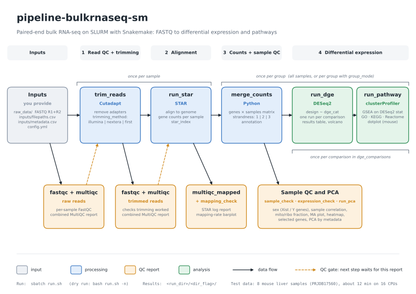

# pipeline-bulkrnaseq-sm

Snakemake pipeline for paired-end bulk RNA-seq on a SLURM cluster: from FASTQ files to QC
reports, STAR alignment, a gene-count matrix, PCA, DESeq2 differential expression and GSEA
pathway analysis.



*Printable version: [docs/pipeline_overview.pdf](docs/pipeline_overview.pdf)*

## Workflow

| Step | Tool | Output |
|------|------|--------|
| Read QC | FastQC + MultiQC | QC report of raw reads |
| Trimming | Cutadapt | Trimmed FASTQs + QC report |
| Alignment | STAR | BAM, gene counts, mapping-rate plot |
| Count matrix | Python | `merged_counts.csv` (genes × samples) |
| Sample QC | R | Sex check, sample correlation, mito/ribo fraction, PCA |
| Differential expression | DESeq2 | Results table + volcano plot per comparison |
| Pathway analysis | clusterProfiler, ReactomePA | GO / KEGG / Reactome GSEA |

Each QC report must exist before the next step starts, so a failed QC stops the run.

## Quick start

**1. Install** (once). The environment names must stay as they are:

```bash
conda install -c conda-forge -c bioconda snakemake
conda env create -f envs/pipeline-bulkrnaseq-sm_env.yml
conda env create -f envs/dge_env.yml
```

**2. Set paths.** In `config.yml` set `run_dir`, and in `run.sh` set `PIPELINE_DIR`, to
your copy of this repository. Set your SLURM account once in `~/.bashrc`:
`export SBATCH_ACCOUNT=<account>`.

**3. Run:**

```bash
bash run.sh -n      # dry run: list the steps without running them
sbatch run.sh       # run on SLURM (16 CPUs, 64 GB, 4 h by default)
```

The repository includes a small **mouse test data set**, so the pipeline runs as soon as
it's cloned. `raw_data/` holds 8 liver samples from public study DDBJ PRJDB17560 (WT vs
Vldlr KO, control vs low-protein diet, 4 female and 4 male), cut to 500k read pairs each.
The full run takes about 12 minutes. See `raw_data/README_test_data.txt`.

## Your own data

Put FASTQs in `raw_data/` (or anywhere else) and fill in two files in `inputs/`:

**`filepaths.csv`**: sample ID, then absolute paths to R1 and R2. Build it with
`bash prerun_filepaths.sh`.

```csv
Barcode,fastq_1,fastq_2
UDI001,/abs/path/SLX-11111.UDI001.AAA111.r_1.fq.gz,/abs/path/SLX-11111.UDI001.AAA111.r_2.fq.gz
```

**`metadata.csv`**: one row per sample. It needs a `Barcode` column matching
`filepaths.csv`, plus `Sample name` and `Sample sex` columns. Any column you name in
`config.yml` must exist.

```csv
Pool,Barcode,Sequence,Sample name,Condition 1,Condition 2,Batch,Sample type,Sample age,Sample sex
SLX-11111,UDI001,CCGCGGTT-AGCGCTAG,F1,control,WT,1,liver,adult,F
```

Then update `config.yml`. The settings you will usually change:

| Setting | Example | What it does |
|---------|---------|--------------|
| `star_index`, `annotation` | `.../mus_musculus/release-113` | Genome index and gene annotation (needs `ensembl_gene_id`, `gene_symbol` columns) |
| `trimming_method` | `illumina` / `nextera` / `first` | Which adapters to trim |
| `strandness` | `1` unstranded, `2` forward, `3` reverse | Which STAR count column to use. Check your library kit |
| `dge_cat` | `"Condition 1"` | Metadata column to compare |
| `dge_comparisons` | `low_protein_vs_control: "control"` | One entry per comparison, as `A_vs_B: B` (B is the reference) |
| `lfc_threshold`, `padj_threshold` | `1.0`, `0.05` | Significance cut-offs |
| `pca_col_cat`, `pca_col_cat_reference` | `"Condition 1,Sample sex"`, `"control,F"` | Columns to colour PCA plots by, and their reference levels (same order) |
| `pca_col_num` | `"Batch"` | Numeric columns for PCA plots |
| `gene_list` | `"Gapdh,Actb"` | Genes to plot (must not be empty) |
| `group_mode`, `split_by`, `groups` | `true`, `"Sample sex"`, `[F, M]` | Analyse each group separately (e.g. males and females) |
| `pathway_organism` | `mouse` | Only mouse is supported |

Other options: `--config exclude="UDI003,UDI007"` drops samples. `bash run.sh --until run_dge`
stops before pathway analysis. `dir_flag` changes the results folder name.

## Outputs

All results go to `<run_dir>/<dir_flag>/` (by default `results_raw/`):

```
multiqc-raw/, multiqc-trimmed/, multiqc-mapped/   QC reports (open multiqc_report.html)
mapping/                 STAR BAMs and gene counts per sample
mapping_check/           mapping-rate barplot
merged-counts/<group>/   merged_counts.csv
sample_check/<group>/    sex heatmap, sample correlation, mito/ribo barplot
expression_check/<group>/  MA plot, heatmap, selected-gene plots
pca/<group>/             PCA plots and pca.csv
dge/<group>/<comparison>/      dge_results.csv, vst_normalised_counts.csv, volcano plot
pathway/<group>/<comparison>/  GO / KEGG / Reactome GSEA tables, dotplot
```

`<group>` is `all` unless `group_mode: true`. `<comparison>` is each entry of `dge_comparisons`.

## Utility scripts

These are in `scripts/` but are not part of the pipeline; run them by hand when needed:
`utils-merge_lanes.sh` (merge per-lane FASTQs), `run_seqtk.sh` (downsample FASTQs),
`run_cutadapt_polyg.sh` (trim NovaSeq poly-G tails), `utils-merge_meta.R` (join facility
sheet to sample metadata), `run_samtools.sh` (deduplicate + featureCounts).

## Known issues

- **Pathway analysis and the mito/ribo plot only work for mouse.** On human data use
  `--until run_dge`. KEGG also needs internet access during the run.
- **STAR filters `filter_score` / `filter_match` are ignored.** The `Snakefile` rounds them
  down to 0.
- **`trimming_method: first`** always trims 5 bp from R2.
- **All three GSEA files are always produced**, whatever `pathway_databases` says.

## Author

Maintained by mk2314, University of Cambridge
